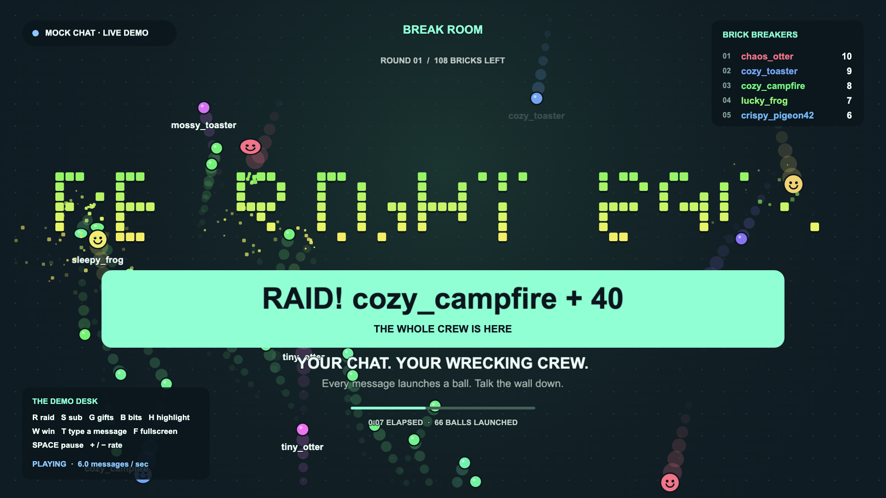
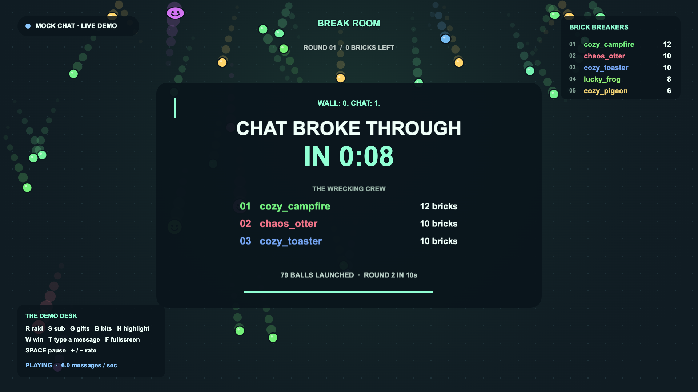

# Break Room

**Take a break. Let chat break things.**

Break Room turns a Twitch BRB screen into a game the whole chat plays. The wall spells your message ("BE RIGHT BACK" by default), and every chat message fires a ball at it. Nobody has to learn a command: saying "hi" counts. Subs fire a fan of gold balls, cheers fire a heavy ball that smashes straight through, and a raid sends a wave of balls across the screen. When the wall falls, chat sees how long it took and who broke the most bricks. Then the wall rebuilds a little tougher, and tougher still if chat is busy.

It's a single web page you add to OBS as a Browser Source. It reads chat anonymously, so there's no login, no token, no bot account and no server.





**Try it:** [live demo with fake chat](https://harindulk.github.io/break-room/?mock=1&bg=1) · [set it up for your channel](https://harindulk.github.io/break-room/)

## Put it on your stream

1. Open the [setup page](https://harindulk.github.io/break-room/), type your channel name and your wall text, and click **Copy OBS URL**.
2. In OBS: **Sources → + → Browser**, paste the URL, set width **1920** and height **1080**.
3. Put the source in your BRB scene, on top of your usual BRB art (the page is transparent), or switch on the dark backdrop.

Works the same in Streamlabs and Meld Studio.

## What chat can do

| On Twitch | In Break Room |
| --- | --- |
| Any chat message | One ball from that chatter's lane, in their name colour |
| Message with an emote | The ball *is* the emote |
| First message in the channel | Ball with a sparkle ring |
| Sub or resub | Fan of 5 gold balls |
| Gift subs | One gold ball per gift |
| Cheer (bits) | A heavy ball that ploughs through bricks; more bits, bigger ball |
| Highlighted message or channel-point message | One giant ball |
| Raid | A wave of balls (one per raider, up to 80) and a big banner |
| Mod or broadcaster types `!rebuild` / `!clear` | Rebuild the wall / clear all balls |

## URL options

| Param | Default | What it does |
| --- | --- | --- |
| `channel` | none | Twitch channel to read |
| `text` | `BE RIGHT BACK` | Wall text; `\|` starts a second line, e.g. `BRB\|5 MIN` |
| `back` | none | Minutes until you're back; shows a countdown |
| `bg` | `0` | `1` adds a dark backdrop |
| `sound` | `0` | `1` turns on sound effects (off by default so nothing leaks to stream audio by surprise) |
| `ui` | `1` | `0` hides the leaderboard and status chip |
| `mock` | `0` | `1` runs fake chat, no Twitch needed |
| `rate` | `1.5` | Fake chat messages per second |

## Testing without a Twitch account

Open [`?mock=1&bg=1`](https://harindulk.github.io/break-room/?mock=1&bg=1). Fake chatters start talking straight away, and the demo desk keys trigger every Twitch event:

`R` raid · `S` sub · `G` 5 gift subs · `B` 500-bit cheer · `H` highlighted message · `W` break the whole wall · `T` type your own message · `Space` pause chat · `+`/`-` chat speed · `F` fullscreen

To test with real chat, open `?channel=<any live channel>`: Break Room only reads, so any public channel works.

## Run it locally

No build step and no dependencies. Serve the folder with any static server:

```bash
npx serve .
```

Then open the printed URL. Tests use Node's built-in runner (Node 20+):

```bash
node --test
```

## How it works

- `src/twitch.js` connects to Twitch chat over the IRC WebSocket as an anonymous `justinfan` user, parses IRCv3 tags (colours, emotes, badges, bits, subs, raids) and turns them into game events. Emote positions are code-point indexes, so emoji before an emote don't break emote balls.
- `src/game.js` runs fixed-step physics at 120 Hz with a spatial grid for brick hits, so a few hundred balls stay smooth.
- `src/render.js` draws everything on one 1920×1080 canvas: trails, particles, hit-stop, shake for big moments, banners. `prefers-reduced-motion` turns shake and slow-mo off.
- `src/mock.js` is the fake chat and demo desk.
- `src/setup.js` builds the OBS URL with a live preview.

## Built with OpenAI Codex

The project started as a written spec ([`SPEC.md`](SPEC.md)) and a short set of working rules for the agent ([`AGENTS.md`](AGENTS.md)). OpenAI Codex built the game from them in one thread: the Twitch parser and client, the physics, the effects, the setup page and the tests.

I playtested every build in a real browser and sent what I found back into the same thread. The second turn fixed faint event banners, raid waves that printed the raider's name on 40 balls, and a white box behind the setup preview. The third drew the HUD above the balls, so the timer stays readable, and made each new wall tougher when chat is busy, so a big channel doesn't flatten it in seconds. Each turn ended with `node --test` passing; there are 29 tests now.

## License

[MIT](LICENSE)
